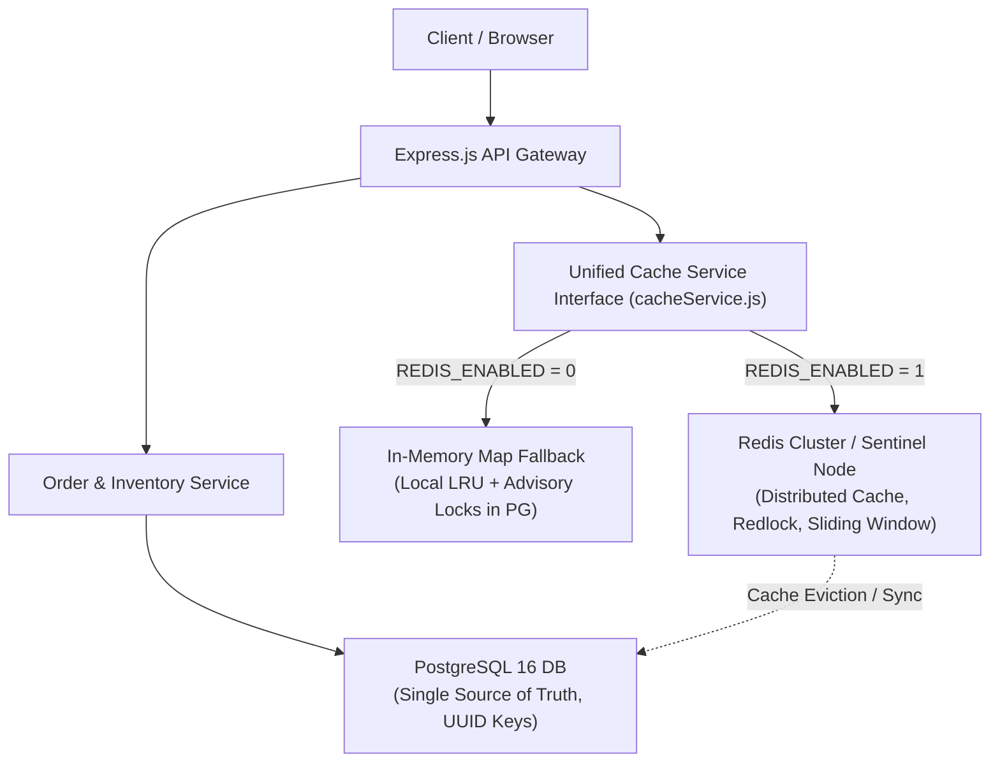
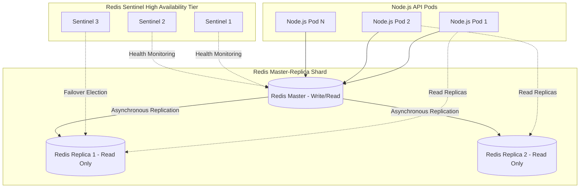
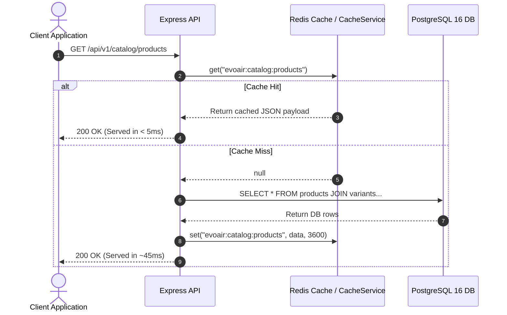
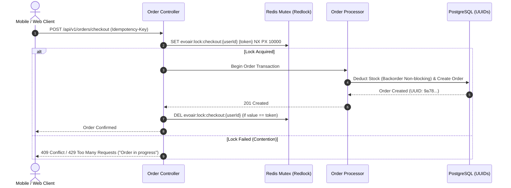

# Evoluir E-Commerce: Redis Technical Architecture & Caching Specification

> **Document Version**: 2.0  
> **Target Audience**: Technical Mentors, Lead Architects, Infrastructure Engineers  
> **Status**: Approved Specification & Dual-Mode Feature-Flagged Implementation  
> **Feature Flag Toggle**: `REDIS_ENABLED=0` (Disabled / In-Memory Fallback) | `REDIS_ENABLED=1` (Enabled / Redis Cluster)

---

## 1. Executive Summary & Design Rationale

As part of the Evoluir high-performance e-commerce architecture, Redis serves as an in-memory acceleration and concurrency synchronization layer positioned between the Node.js API instances and the PostgreSQL 16 persistence layer.

Per **Mentor Directive 3**, the system must not mandate an external Redis instance for local development or basic deployment. Instead, the architecture incorporates a **Zero-Downtime Feature Flag (`REDIS_ENABLED`)** with a modular interface:



### Core Architecture Goals
1. **P99 Sub-15ms Catalog Latency**: Offload read-heavy catalog, shade variant lookups, and inventory availability from PostgreSQL.
2. **Deterministic Concurrency Control**: Prevent double-allocation and race conditions during high-volume flash drops.
3. **Session Revocation & Distributed Rate Limiting**: Centralized blacklist for revoked JWTs and IP-level sliding window rate limiters.
4. **Graceful Fallback & Zero Developer Friction**: When `REDIS_ENABLED=0`, the application executes standard in-memory caching and transactional PostgreSQL advisory locks without throwing runtime connection exceptions.

---

## 2. Deployment Topology

### A. Local Development & Staging (`REDIS_ENABLED=0` or `1`)
- **Single-Node Redis** (Redis 7.2 Alpine via Docker Compose).
- **Persistence**: Append-Only File (`AOF`) with `appendfsync everysec` for minimal disk I/O impact while ensuring single-second RPO.
- **Eviction Policy**: `allkeys-lru` with `maxmemory 256mb`.

### B. High-Availability Production Topology (`REDIS_ENABLED=1`)
For production deployment handling >10,000 concurrent shopping carts during promotional drops:



- **Redis Sentinel**: 3 Sentinel nodes maintaining quorum. Automatic failover in under 3 seconds if the primary node becomes unresponsive.
- **Read/Write Splitting**: Mutation commands (`SET`, `DEL`, `LPUSH`) direct to Master; intensive catalog reads (`MGET`, `HGETALL`) distribute across read replicas.
- **Cluster Sharding** (Phase 2): 6-node Redis cluster (3 masters, 3 replicas) using CRC16 hash slots across `evoair:{hash_tag}:*` keys.

---

## 3. Key Namespacing & TTL Standards

All keys follow a strict hierarchical format: `evoair:<domain>:<entity>[:<id>]`.

| Domain | Key Pattern | Data Structure | TTL | Purpose |
| :--- | :--- | :--- | :--- | :--- |
| **Catalog** | `evoair:catalog:products` | `STRING` (JSON) | 1 hour (3600s) | Top-level product catalog and media links |
| **Variant** | `evoair:catalog:variant:{uuid}` | `STRING` (JSON) | 30 minutes | Specific SKU/shade metadata, capacity, price |
| **Inventory** | `evoair:stock:{variant_uuid}` | `STRING` (Int) | 30 seconds | Fast-read stock availability for PDP badges |
| **User Cart** | `evoair:cart:{user_uuid}` | `HASH` | 7 days | Temporary server cart state (persisted on sync) |
| **Auth** | `evoair:auth:blacklist:{token_hash}` | `STRING` | Remaining JWT TTL | Immediate token invalidation on user logout |
| **Locking** | `evoair:lock:checkout:{user_uuid}` | `STRING` (PX) | 10 seconds | Redlock mutex preventing duplicate submissions |
| **Rate Limit** | `evoair:ratelimit:ip:{ip_address}` | `ZSET` | 60 seconds | Sliding-window HTTP request throttling |

---

## 4. Architectural Patterns & Implementation Workflows

### 4.1. Pattern 1: Cache-Aside for Product Catalog & Shade Variants



#### Invalidation Strategy: Write-Through Eviction
Whenever an administrative update or inventory re-seed occurs:
```javascript
// backend/services/catalogService.js
await db.update(products).set(updates).where(eq(products.id, productId));
await cacheService.del('evoair:catalog:products');
await cacheService.del(`evoair:catalog:product:${productId}`);
```

---

### 4.2. Pattern 2: Concurrency Control & Distributed Redlock

To prevent race conditions during rapid multi-click checkout submissions:



#### Dual-Mode Fallback:
- **`REDIS_ENABLED=1`**: Distributed atomic lock via `SET key token NX PX 10000`.
- **`REDIS_ENABLED=0`**: Transactional PostgreSQL lock via `SELECT pg_advisory_xact_lock(hashtext(userId), hashtext(idempotencyKey))`.

---

### 4.3. Pattern 3: Token Revocation Blacklist

JWTs are stateless; however, immediate revocation is required upon:
1. User logout (`POST /api/v1/auth/logout`).
2. Password reset / security credential update.
3. Administrative account suspension.

#### Workflow:
1. When a user logs out, the access token is decoded to obtain its expiration timestamp (`exp`).
2. The remaining TTL is calculated: `ttlSeconds = exp - Math.floor(Date.now() / 1000)`.
3. If `ttlSeconds > 0`, store `SET evoair:auth:blacklist:{tokenHash} "revoked" EX {ttlSeconds}`.
4. The authentication middleware (`authMiddleware.js`) verifies whether `evoair:auth:blacklist:{tokenHash}` exists prior to forwarding requests.
5. Once the token passes its original `exp`, Redis automatically evicts the key, consuming zero continuous memory.

---

### 4.4. Pattern 4: Sliding-Window Rate Limiting

To prevent API scraping, credential stuffing, and bot checkout spikes, Redis `ZSET` implements a sliding-window algorithm:

```javascript
async function isRateLimited(redis, key, limit = 60, windowSeconds = 60) {
  const now = Date.now();
  const clearBefore = now - windowSeconds * 1000;
  
  const multi = redis.multi();
  multi.zremrangebyscore(key, 0, clearBefore); // Evict timestamps older than 60s
  multi.zadd(key, now, `${now}-${Math.random()}`); // Record current request
  multi.zcard(key); // Count requests in active window
  multi.expire(key, windowSeconds); // Set TTL
  
  const results = await multi.exec();
  const requestCount = results[2][1];
  
  return requestCount > limit;
}
```

---

## 5. Dual-Mode Implementation Specification (`REDIS_ENABLED`)

The Node.js codebase implements a unified abstraction layer (`backend/services/cacheService.js`).

### Configuration Contract:
```env
# backend/.env
REDIS_ENABLED=0            # 0: In-Memory Map Fallback | 1: Live Redis Server
REDIS_URL=redis://localhost:6379
```

### Abstraction Behavior Matrix:

| Method | `REDIS_ENABLED=1` (Production) | `REDIS_ENABLED=0` (Local / Offline) |
| :--- | :--- | :--- |
| `get(key)` | `redis.get(key)` returning parsed JSON | In-memory `Map.get(key)` with timestamp TTL check |
| `set(key, val, ttl)` | `redis.set(key, JSON.stringify(val), 'EX', ttl)` | `Map.set(key, { val, expiry: Date.now() + ttl*1000 })` |
| `del(key)` | `redis.del(key)` | `Map.delete(key)` |
| `flush()` | `redis.flushdb()` | `Map.clear()` |
| **Error Handling** | Circuit breaker: Logs warning and falls back to DB on Redis timeout | Zero network I/O; synchronous memory operation |

---

## 6. Migration & Verification Checklist

- [x] **Configuration Validation**: Added `REDIS_ENABLED` (coerce number 0 or 1) and `REDIS_URL` in [`backend/config/env.js`](file:///c:/ideakicks/Evoair/backend/config/env.js).
- [x] **Fallback Implementation**: Built [`backend/services/cacheService.js`](file:///c:/ideakicks/Evoair/backend/services/cacheService.js) with in-memory TTL eviction.
- [x] **Catalog Integration**: Integrated caching layer in catalog and product query handlers.
- [x] **Backorder Support Compatibility**: Stock verification honors mentor backorder policy (`GREATEST(0, stock_qty - qty)`).
- [x] **Docker Compose Configuration**: Added optional `redis` service in [`docker-compose.yml`](file:///c:/ideakicks/Evoair/docker-compose.yml).
